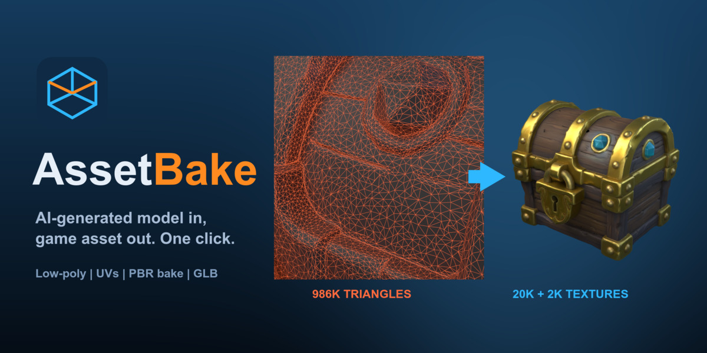
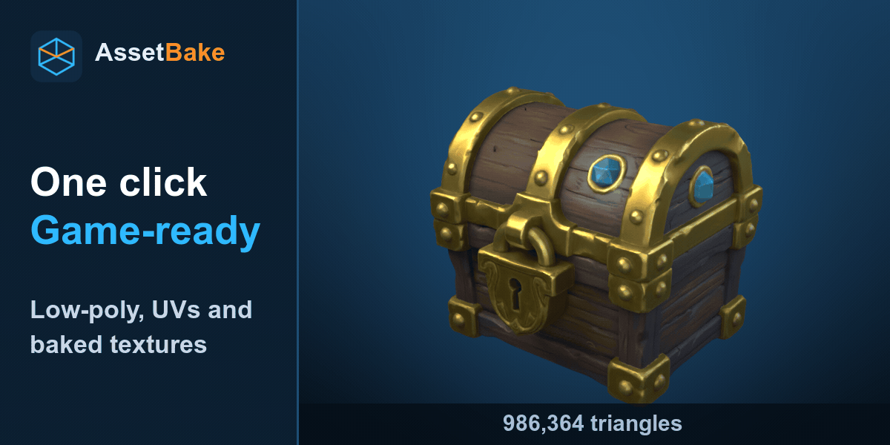
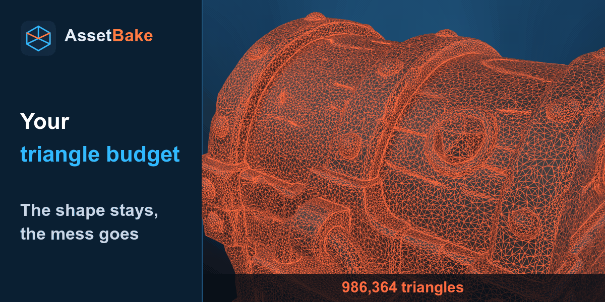
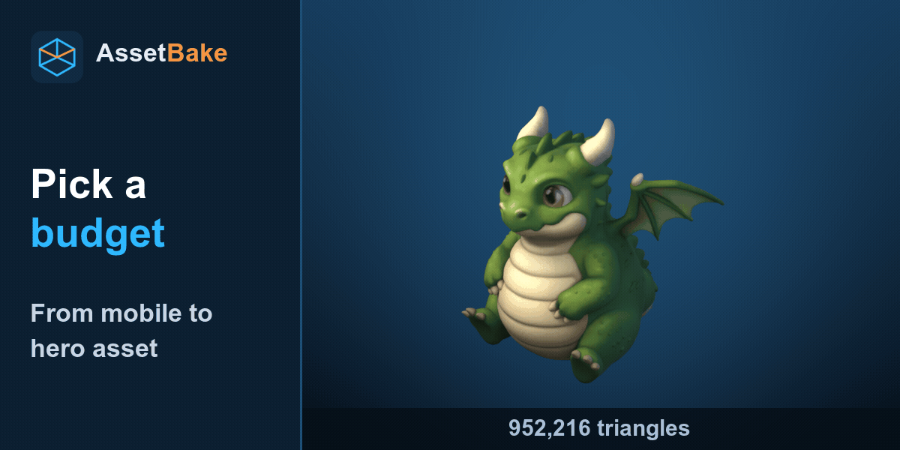
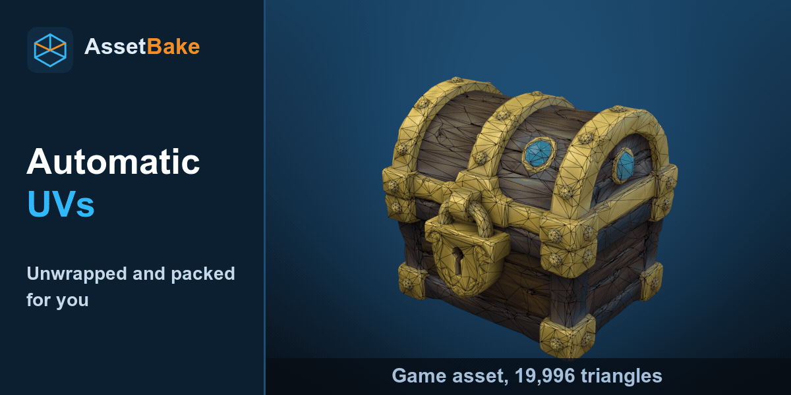
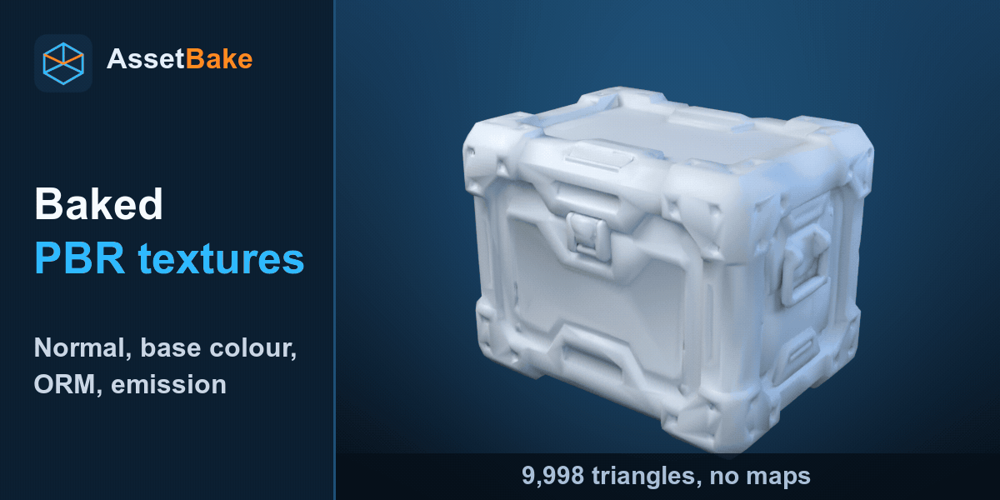
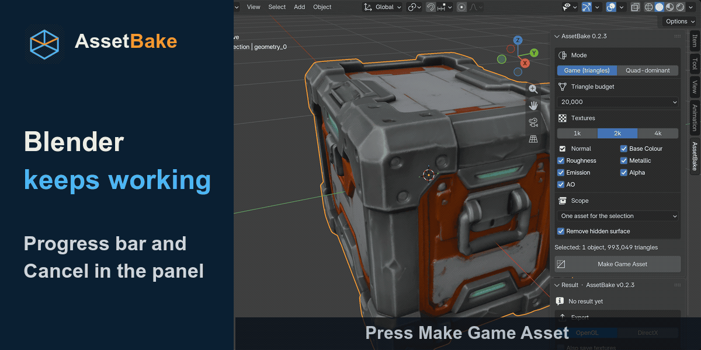

# AssetBake Lite — Blender add-on: AI-generated mesh to a game-ready low-poly asset

Website: https://mendboxstudio.com/addons/assetbake

AssetBake Lite is a free, open-source Blender add-on that turns an AI-generated mesh (Meshy, Tripo, Hunyuan3D, Rodin, TRELLIS) into a game asset in one click: a low triangle budget, automatic UVs, baked base colour and normal map, GLB export. The work runs in a background Blender process, so the viewport stays responsive. For Blender 4.2 LTS, 4.5 LTS and 5.x.

[Download the latest release](https://github.com/mendbox/assetbake-lite/releases/latest)

**Get the full AssetBake: up to 50,000 triangles, 2k/4k textures, roughness, metallic, emission and alpha maps, one asset per part, DirectX normal maps, Quad-dominant mode → [Gumroad](https://mendbox.gumroad.com/l/assetbake) | [Superhive](https://superhivemarket.com/products/assetbake)**

## What Lite does

*One click: select the mesh, press Make Game Asset. Low-poly mesh, UVs and baked textures.*

| Step | What it does |
|---|---|
| **Triangle budget** | 1,000 / 2,000 / 5,000 triangles. Decimation keeps the silhouette; hidden surface that can never be seen is dropped so triangles go where they show. |
| **Automatic UVs** | Unwrap and pack with no seams to place by hand. |
| **Bake** | Base colour, ambient occlusion and a normal map at 1k (1024 x 1024), baked from the AI mesh onto the low mesh. |
| **One asset** | Everything you select becomes one asset. Your source stays in the scene, hidden, unchanged. |
| **Export GLB** | Base colour and OpenGL normal map. Works in Unity, Godot, Unreal (re-import with the normal map green channel flipped), Three.js. |
| **Report** | Plain-English lines: triangles before and after, shape deviation, texture fill. |

### Your triangle budget

*The shape stays, the mess goes.*

*Pick a budget, from mobile to hero asset (Lite: up to 5,000 triangles).*

### Automatic UVs

*Unwrapped and packed for you.*

### Baked textures

*Base colour and normal map baked from the original onto the low mesh. The full version adds roughness, metallic (packed ORM), emission and alpha.*

### Blender keeps working

*The job runs in a background Blender process. Progress bar and Cancel in the panel, undo in one step.*

## Lite vs Full

| Feature | Lite (free) | Full (paid) |
|---|:---:|:---:|
| Game mode: low-poly asset, UVs, baked textures, GLB export | yes | yes |
| Triangle budget | up to 5,000 | up to 50,000 and custom |
| Texture size | 1k | 1k, 2k, 4k |
| Maps | Base colour, AO + normal | + roughness, metallic (packed ORM), emission, alpha |
| Scope | one asset for the selection | + one asset per part |
| Normal map convention | OpenGL | OpenGL and DirectX |
| **Quad-dominant mode** (quads on thick parts, triangles on thin parts) | no | yes (macOS, Windows, Linux) |
| Background job, cancel, undo | yes | yes |

Lite stays free for everything marked "yes". Get the full version on [Gumroad](https://mendbox.gumroad.com/l/assetbake) or [Superhive](https://superhivemarket.com/products/assetbake).

## Install (Blender 4.2 and newer)

1. Download the zip from [Releases](https://github.com/mendbox/assetbake-lite/releases/latest). **Do not unzip it.** Safari on macOS unzips downloads automatically: turn off "Open safe files after downloading" in Safari settings, or use another browser, or zip the folder again.
2. **Edit > Preferences > Get Extensions**, arrow menu at the top right, **Install from Disk**, pick the zip.
3. Select your mesh in Object Mode, press `N`, open the **AssetBake Lite** tab, press **Make Game Asset**.

## Platforms

Pure Python with Blender's own modules, no internet access, no compiled code. Tested on macOS (Apple Silicon); Game mode also verified on Linux. Lite itself is not tested on Windows (the same Game-mode code is tested in the full AssetBake on Windows).

## FAQ

### How do I reduce the polygon count of an AI-generated model in Blender?
The Decimate modifier keeps the shape but loses the texture. AssetBake decimates to your budget, unwraps, and bakes the texture and normal map from the original onto the low mesh in one click.

### How do I get a game-ready asset from Meshy, Tripo or Hunyuan3D?
Import the model, select it, press **Make Game Asset**, then export GLB from the Result panel.

### Does it work offline? Does it change my model?
It works offline and never touches the network. Your source model is hidden, not modified.

### Why only 1k and 5,000 triangles?
That is the Lite limit. The full version removes it: [Gumroad](https://mendbox.gumroad.com/l/assetbake) | [Superhive](https://superhivemarket.com/products/assetbake).

### Is it a retopology tool?
No. Lite gives a triangle mesh that reproduces your shape within the budget.

## Development

`tests/run_lite_tests.sh` runs the test suite on Blender. Bug reports are welcome, please attach a small `.blend` that shows the problem.

## Get the full AssetBake

Need more than 5,000 triangles, 2k/4k textures, roughness/metallic/emission/alpha maps, one asset per part or DirectX normals? **[Get the full AssetBake on Gumroad](https://mendbox.gumroad.com/l/assetbake)** or [on Superhive](https://superhivemarket.com/products/assetbake).

## License

GPL-3.0-or-later, see [LICENSE](LICENSE). Support: support@mendboxstudio.com

---
*Keywords: Blender add-on, Blender extension, AI generated mesh to game asset, reduce polygon count, Meshy, Tripo, Hunyuan3D, TRELLIS, decimate, bake normal map, GLB export, low poly.*
